


  

  

  

<h3><code>richard@github ~ $ whoami</code></h3>

 

## 4MA OS — agents & orchestrator

`🟥 LIVE AT ZERO GROUP`

*AI prepares. Humans decide.*

**Models:** Ollama + Qwen locally for routine work · Claude Opus 5.5 / Sonnet 5.5 and DeepSeek V4 Pro for harder tasks and development

- 14 domain agents working from shared rules and skills
- Live flows: lead → contract, invoice → payment with a stop above the spending limit, ticket → resolution
- 95% of routine tasks run on their own, 5% wait for manager approval
- Manager corrections feed back into how the agents work — and the agents' look is inspired by Valorant

<a href="https://richard-portfolio-2026-27.vercel.app/">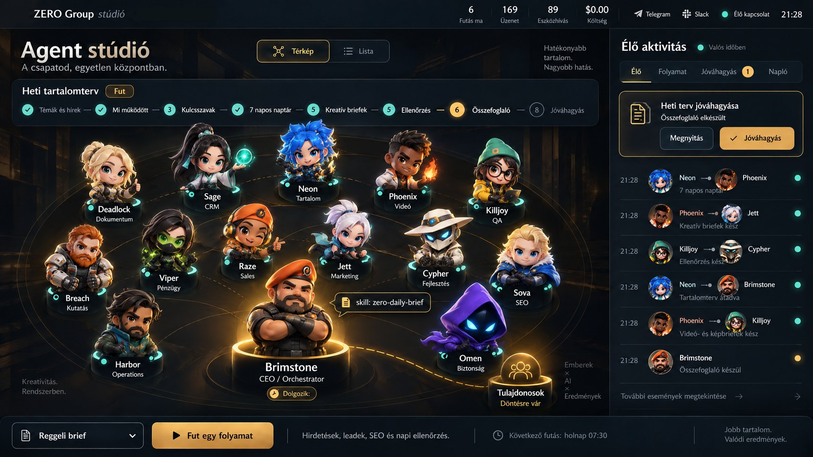</a>

### Modules running on 4MA

<table>
<tr>
<td valign="top">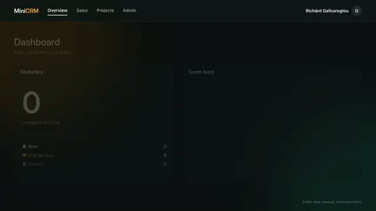 <b>MiniCRM</b> · <code>LIVE</code> Lead → finished project: automatic quotes, panel &amp; inverter selection from client data and a map, a solar–inverter–battery simulator in Go, GPS fleet management.</td>
<td valign="top"> <b>Marketing Intelligence</b> · <code>LIVE</code> Google Ads, Meta, GA4, Search Console and Tag Manager in one place. Replaced an agency's manual work — 131 leads since full automation.</td>
<td valign="top">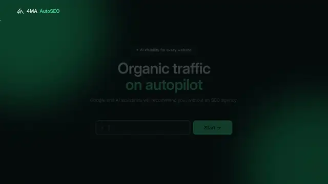 <b>AutoSEO</b> · <code>IN DEVELOPMENT</code> A 30-day content plan from one URL: tech detection, competitors, Search Console &amp; Analytics, site health.</td>
</tr>
</table>

 

## More systems I built

<table>
<tr>
<td valign="top">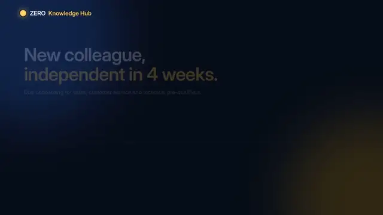 <b>ZERO Knowledge Hub</b> · <code>LIVE</code> Onboarding for new colleagues in sales and operations: learning cards, tests, real cases, mentor sign-off and measurable progress.</td>
<td valign="top">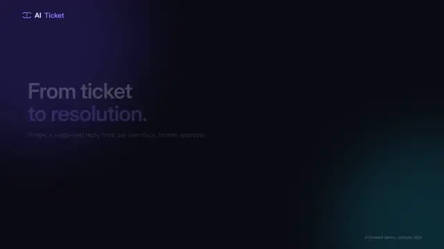 <b>AI ticketing system</b> · <code>LIVE</code> Triages incoming tickets and suggests replies from document search (RAG, embeddings), with structured logging and error handling.</td>
</tr>
<tr>
<td valign="top">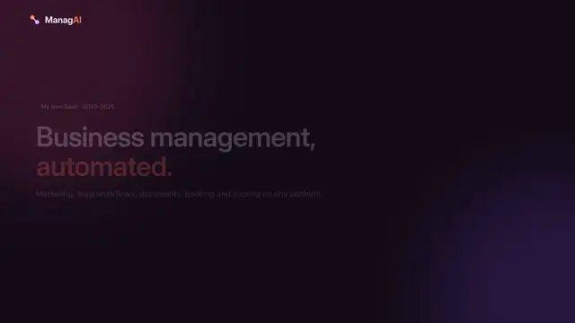 <b>ManagAI</b> · <code>SOLD 2025</code> My own business-management SaaS. 3-month live pilot in five countries: 5 annual + 13 monthly subscribers, 41 trials. Sold on Acquire.com to a German buyer.</td>
<td valign="top">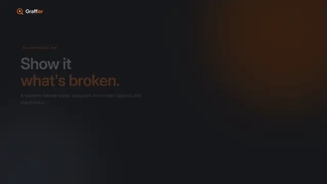 <b>Graffler</b> · <code>MVP</code> Suggests troubleshooting and repair steps for broken objects and electronics from a camera image. Decision support, not automatic diagnosis.</td>
</tr>
</table>

 

## In development — 2026/27 projects

Illustrations of what each app does, not screenshots.

<table>
<tr>
<td valign="top">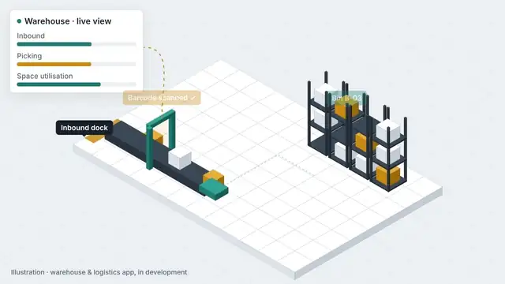 <b>Warehouse &amp; logistics</b> Inbound, barcode scanning, bin location and picking in one interface.</td>
<td valign="top">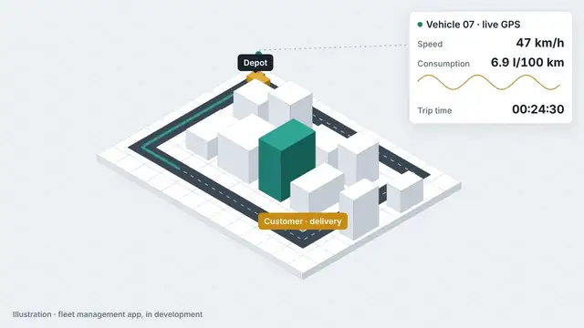 <b>Fleet management</b> GPS-tracked vehicles with fuel consumption, trip time and other trip data.</td>
</tr>
<tr>
<td valign="top">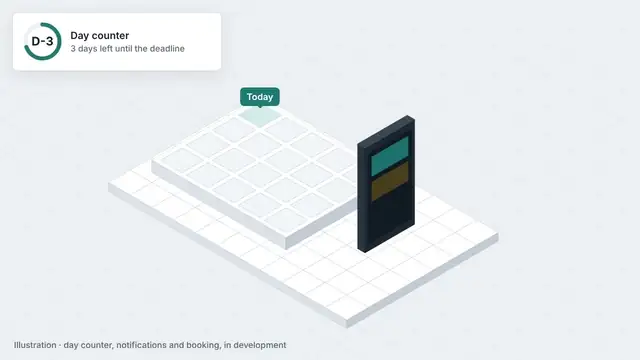 <b>Day counter &amp; notifications</b> Bookings, reminders and confirmations for booking systems.</td>
<td valign="top">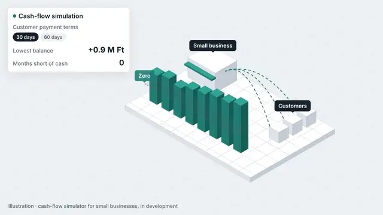 <b>Cash-flow simulator</b> What happens when customers pay in 60 days instead of 30 — month by month.</td>
</tr>
<tr>
<td valign="top">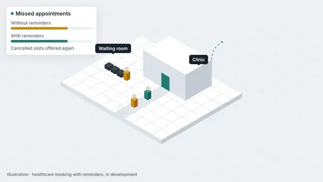 <b>Healthcare booking</b> Fewer missed appointments through reminders; cancelled slots offered again.</td>
<td valign="top">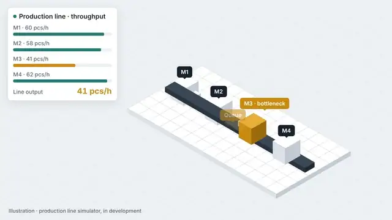 <b>Production-line bottleneck</b> Simulates each machine's throughput and finds the one slowing the line.</td>
</tr>
<tr>
<td valign="top">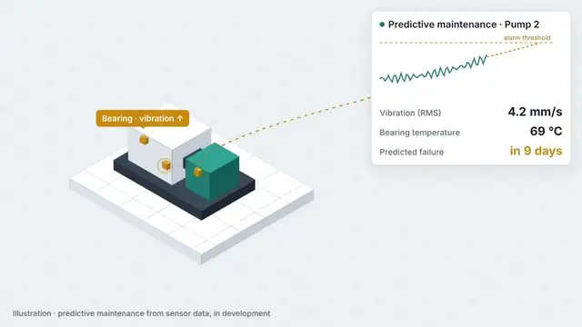 <b>Predictive maintenance</b> Estimates failures from vibration and temperature data and opens a ticket first.</td>
<td valign="top">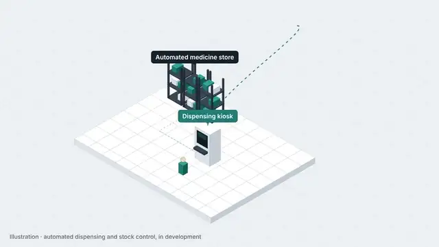 <b>Medicine dispensing</b> Scan the prescription, get the medicine with the right paperwork; doctor and patient notified.</td>
</tr>
<tr>
<td valign="top">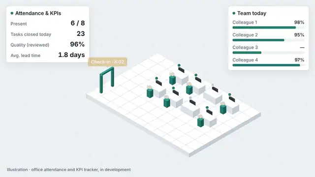 <b>Office attendance &amp; KPIs</b> Attendance, closed tasks, lead time and reviewed quality, measured.</td>
<td valign="top">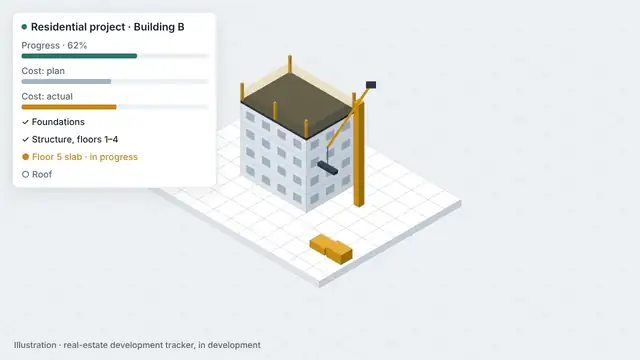 <b>Real-estate tracker</b> Construction progress, costs and status that everyone can follow.</td>
</tr>
</table>

 

<h3><code>richard@github ~ $ cat stack.txt</code></h3>

  

Next project with: →&nbsp;

  

<h3><code>richard@github ~ $ ./contributions.sh</code></h3>

 

### `$ cat now.md`

- [x] Sell ManagAI and hand it over to its new owner
- [x] Put a 14-agent system into production at ZERO GROUP
- [ ] Rebuild 4MA from scratch as a self-hosted SaaS with 4 pricing tiers
- [ ] Launch a new AI venture for EU &amp; US markets in 2027

> [!TIP]
> **Open to work:** Medior AI Engineer · Forward Deployed Engineer roles — remote, with one day a week in Budapest if needed, and open to working abroad.

Cards and banners are SVGs generated by Python; the demo loops are built from my portfolio videos by a GitHub Action. The heatmap re-syncs every morning.

