  

<h3><code>richard@github ~ $ whoami</code></h3>

  

<h3><code>richard@github ~ $ ./4ma --watch</code></h3>

 

### `$ ls ./projects`

| Project | What it does | Status |
| :-- | :-- | :-- |
| **4MA OS** | Self-hosted multi-agent business OS: a 14-agent orchestrator plus AutoSEO, MiniCRM and marketing analytics modules. Routine work runs on local Ollama/Qwen, hard tasks on Claude / DeepSeek. | 🟥 live testing |
| **4MA AutoSEO** | AI auto-blogging and SEO / GEO / AEO engine for Hungarian SMEs | 🟧 nearly done |
| **Grelio AI** | Hungarian-first multi-tenant CRM + AI assistant (Next.js 14, Supabase, Stripe) — built with a partner | 🟧 in development |
| **Graffler** | Point your camera at something broken, get repair steps | 🟨 MVP |
| **ManagAI** | Automated business-management SaaS with its own workflow builder | ✅ acquired 2025 |
| **Marketing automation stack** | n8n pipelines on a VPS: daily AI video generation and social auto-publishing | ✅ running |

<b>🧪 Hobby builds &amp; simulators</b>

 

- Warehouse / logistics app
- Fleet management — GPS tracking, fuel consumption, trip time
- Day-counter &amp; notifications for booking systems
- Next up: cash-flow simulator (30 vs 60-day terms), production-line bottleneck finder, predictive maintenance from sensor data

<!--
  DEMÓ VIDEÓK (iso-flow) — két lehetőség:

  1) Lejátszó (kattintásra indul): a GitHub szerkesztőben húzd be az .mp4-et IDE
     egy üres sorba. A GitHub feltölti, és beír egy
     https://github.com/user-attachments/assets/... linket. Ha a link KÜLÖN SORBAN
     áll, videólejátszóként jelenik meg. Utána töröld ki a kommentjelet a blokk körül.

  2) Magától, végtelenítve induló animáció: GIF-ként / animált WebP-ként kell
     berakni, pl.  

### `$ ./demo --play`

<b>▶ 4MA — iso-flow demo</b>

 

https://github.com/user-attachments/assets/IDE-JON-A-VIDEO-LINKJE

-->

 

<h3><code>richard@github ~ $ cat stack.txt</code></h3>

  

learning →&nbsp;

  

<h3><code>richard@github ~ $ ./contributions.sh</code></h3>

 

### `$ cat now.md`

- [x] Ship ManagAI and hand it over to its new owner
- [x] Combine orchestrator, MiniCRM, AutoSEO and analytics into one 4MA platform
- [ ] Rebuild 4MA from scratch as a self-hosted SaaS with 4 pricing tiers
- [ ] AWS / Azure / Google Cloud AI certifications
- [ ] Launch a new AI venture for EU &amp; US markets in 2027

> [!TIP]
> **Open to work:** Medior AI Engineer · Forward Deployed Engineer roles — fully remote or flexible hybrid (Hungary: Budapest / Debrecen, or abroad).

Every animation on this page is a plain SVG generated by Python — no JavaScript, no third-party stats service. The heatmap re-syncs daily via GitHub Actions.

